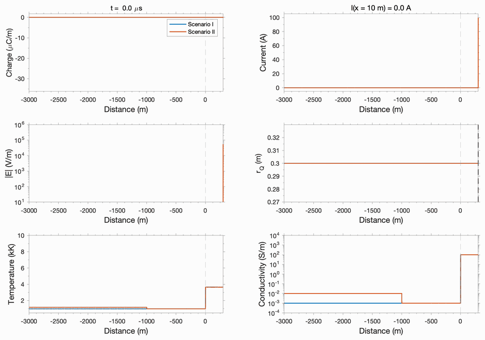
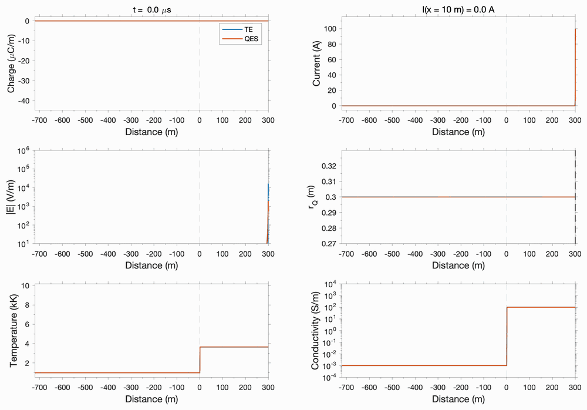

# DARTESS — code documentation

**DARTESS** (**D**art-leader **A**cceleration & **R**etardation via **T**hermo-**E**lectric
**S**imulation **S**cheme) is a one-dimensional, time-domain model of a **horizontal dart leader
propagating along a partially decayed intracloud lightning channel**. This document describes
the code: its equations, numerics, inputs, and outputs. `README.md` is the short version (what
the code is and how to run it).

The channel is a lossy, nonlinear transmission line governed by the **Telegrapher's Equations**.
Its resistance per unit length is not prescribed. It is derived from a temperature- and
field-dependent conductivity that evolves in time, so the **speed of the reactivation front is
an emergent property** of the simulation, not an input.

A **quasi-electrostatic (QES) solver** is available as an option (`iQES = 1`). It replaces the
Telegrapher's Equations with Ohm's law plus a capacitance-kernel potential, in the manner of the
Pantuso & da Silva upward-leader models, and exists to check that the front dynamics come from
the reactivation physics rather than from the choice of electrodynamic formulation.

DARTESS was adapted from two open-source lightning models: the TERS return-stroke model
([open-lightning-models/ters1](https://github.com/open-lightning-models/ters1)), which provides
the transmission-line framework, and the TELLS upward-leader model
([open-lightning-models/tells1](https://github.com/open-lightning-models/tells1)), which
provides the thermodynamic conductivity closure and the quasi-electrostatic kernel.

Language: MATLAB, developed and tested on **R2016a**. No toolboxes are required.

---

## 1. Files

```
dartess.m              THE MODEL: input parameters, solver, saving of results. Produces no figures.
plotWaveFront.m        front position, speed and field at the front, for one or more saved runs (Sec. 8)
gen1Dmov.m             frame-by-frame animation (optionally MP4) of one or more saved runs (Sec. 8)
src/
  getTopResDir.m       location of the results folder (Sec. 7)
  getWaveSpeed.m       front-trajectory binning and speed statistics (Sec. 8)
  getEambE0s.m         E0 and s of a saved run's ambient field (Sec. 7)
README.md              short overview and how to run
reproducibility.csv    inputs of every simulation in the main article (Sec. 2)
documentation.md       this file
LICENSE                GNU Affero General Public License v3.0
```

Every script starts with `if exist('src','dir'), addpath('src'); end`, so run each one from the
folder that contains it.

`dartess.m` runs in this order:

> universal constants → input parameters → derived constants → input validation → grids →
> preallocation → initial conditions → (QES kernel) → **main loop** → final snapshot and trim →
> save `drs.mat`

**Version.** `dartess.m` records its version twice, in the `Code version` line at the end of
its header and in the variable `codeVersion`, and saves it in every result as `drs.version`.
All other files share that version.

---

## 2. Running the model

1. Edit the input block near the top of `dartess.m` (`%% Input params`). Each parameter has a
   one-line comment; Section 7 is the long form.
2. Run it, interactively (`dartess` from its folder) or in batch:

   ```bash
   matlab -nodisplay -nosplash -nodesktop -r "try, run('dartess.m'); catch e, disp(getReport(e)); end; exit" > run.log 2>&1 &
   ```

3. Results are written to `getTopResDir(caseName)`, by default `runs/<caseName>/drs.mat` next to
   `dartess.m`, together with a copy of the script that produced them. **A run with an existing
   `caseName` overwrites it**, so give every run its own name.
4. Inspect the run with `plotWaveFront.m` or `gen1Dmov.m` (Sec. 8).

The shipped input values are the reference case of the main article: a conducting section
followed by a cutoff section (Scenario I), a tip current of 100 A, a cutoff conductivity of
1e-3 S/m, `dx` = 0.5 m, and 800 µs. Run time grows with `tmax` and with the number of grid
cells the front has reached.

### Reproducing the simulations in the main article: `reproducibility.csv`

`reproducibility.csv` lists the input parameters of every simulation used in the main article,
including runs quoted only in its text. There is one row per run.

| Column | Content |
|---|---|
| `figure` | where the run appears in the main article (a figure and panel, or a section for runs quoted only in the text); a run used in several places lists them all, separated by `;` |
| `folder` | the name the run's results folder had (use it, or any name, as `caseName`) |
| `xmin` … `Ntsave` | the 32 inputs of the `%% Input params` block of `dartess.m`, under the code's own names and in its SI units (`tmax`, `dt`, `toff` in s; `h` in km). Vectors use MATLAB syntax, e.g. `[300 0]` |

To rerun a row, set every listed input in `dartess.m` to the row's value. Inputs that are the
same in every row still appear in every row. Three columns need care:

- **`dt`** is 1e-9 s in every row, the time-step ceiling those runs used; the shipped default is
  10e-9. The difference is immaterial for TE runs at `dx` ≤ 0.61 m, where the Courant limit is
  lower than either, but it matters for the `dx` = 0.75, 1 and 3 m runs and the QES run. Copy
  `dt` from the file.
- **`Eamb`** is in the current `[E0 s]` form (Sec. 7). The ambient-field runs were made by an
  earlier version that took the field at the two domain ends; the two forms describe the same
  field. The values are rounded to 10 significant figures, so a rerun matches to roundoff.
- **`toff`** is `2*tmax`, i.e. the tip-current decay is off.

---

## 3. Geometry, grids, and sign conventions

### Coordinate system

The channel is horizontal, and `x` **decreases** along the direction of propagation:

```
xI = xmax : -dx : xmin        % xI(1) = xmax = leader tip (right)
                              % xI(end) = xmin = far end (left)
```

The dart leader starts at `x = xmax` and propagates toward negative `x`. `x = 0` separates the
two sections of the default initial channel:

- `x > 0`: **conducting section**, still warm from recent activity, high conductivity;
- `x <= 0`: **cutoff section**, cooled and largely de-ionized, conductivity many orders lower.

That split is the first two entries of a general junction profile (`xjunc`/`S0junc`, Sec. 5),
which can define any number of sections. `x = 0` keeps one special role regardless: it is where
the front search begins (Sec. 6).

Because `xI` is already decreasing, plots use `xlim([xmin xmax])` directly.

### Staggered grids

| Grid | Definition | Length | Variables |
|------|-----------|--------|-----------|
| `xI` | `xmax:-dx:xmin` | `Nx` | `I`, `R`, `T`, `S` |
| `xV` | `xI(1:Nx-1) - dx/2` | `Nx-1` | `Q`, `V`, `C`, `rQ` |
| `xE` | `xI(2:end-1)` | `Nx-2` | `E` (from `diff(V)`) |

⚠️ Because the grid runs in decreasing `x`, `E = -dV/dx` is computed as `+diff(V)/dx`.

### Variable names

| Symbol | Quantity | Units | Grid |
|--------|----------|-------|------|
| `I` | current | A | `xI` |
| `Q` | charge per unit length (the primary electrostatic state variable) | C/m | `xV` |
| `V` | potential (derived from `Q`; total, including any ambient part) | V | `xV` |
| `E` | electric field, `E = -dV/dx` | V/m | `xE` |
| `R` | resistance per unit length | Ω/m | `xI` |
| `C` | capacitance per unit length (per node, from the sheath radius `rQ`) | F/m | `xV` |
| `rQ` | corona sheath (charge) radius | m | `xV` |
| `T` | temperature (thermodynamic closure only) | K | `xI` |
| `S` | electrical conductivity (thermodynamic closure only) | S/m | `xI` |
| `Vamb` | ambient potential, fixed (Sec. 4.2b) | V | `xV` |

Lowercase or camelCase names are the per-node coefficients of the thermodynamic closure
(`Cheat`, `kappa`, `SLTE`, `epsNEC`, `eta`, `delta`, `nui`, `nua`, `nu`). An underscore marks a
second evaluation of the same quantity: `dTdt_1`/`dTdt_2` are the predictor and corrector rates,
and `_Q`/`_I` mark a value evaluated where `Q` or `I` lives (e.g. `Ek_Q`, the breakdown field on
the charge grid). Previous-step copies carry an `o` suffix (`Vo`, `Qo`, `Io`, `Ro`, `To`, `So`).

### Current sign

The equations keep their textbook `-dV/dx`, `-dI/dx` form on a decreasing grid, so **a positive
`I` inside the arrays flows toward `-x`**, i.e. into the domain. The input currents `Ijunc` use
the standard `+x` sense, so the tip boundary condition negates the tip current
(`I(1) = -Ilead1`). With this convention a positive `Ijunc(1)` drains positive charge and leaves
the channel **negatively** charged, as in an intracloud dart leader.

The saved current snapshots use the input convention again, `Isave(ksave,:) = -I`. **Exception:**
`drs.Igt` (the tip current every step) is saved in the internal array sign, opposite to
`drs.Isave`.

---

## 4. Governing equations

### 4.1 Electrodynamics

**`iQES = 0`: Telegrapher's Equations (FDTD), the default.** Inductance is retained, so
electromagnetic signals propagate at `v = 1/sqrt(L*C)`, close to the speed of light:

```
L dI/dt = -dV/dx - R*I          (current equation)
  dQ/dt = -dI/dx + i_ext        (charge continuity)
      V = (Q - Q0)/C + Vamb     (local closure, elementwise)
```

`Q` is the primary state variable and `V` is derived from it, which keeps the charge budget
explicit. `i_ext` [A/m] is the lateral current injected at interior channel junctions (Sec. 5),
`i_ext = sum_n Ijunc(n)*delta(x - xjunc(n))` over every junction except the tip, which uses the
boundary condition instead. It enters the continuity equation only: a junction delivers charge
transversely, not an axial EMF. It is zero unless an interior junction carries a nonzero current.

**`iQES = 1`: quasi-electrostatic.** The inductive term is dropped, leaving Ohm's law, and the
local closure is replaced by a nonlocal capacitance kernel:

```
I = -(1/R) dV/dx                              (Ohm's law)
dQ/dt = -dI/dx + i_ext                        (unchanged)
V_i = sum_j Aker(i,j) * (Q_j - Q0) * dx  +  Vamb_i
```

with the uniformly-charged-disk kernel of Pantuso & da Silva (2024, Eq. 6), after Attanasio et
al. (2019):

```
Aker(i,j) = (2*kC/rQss^2) * ( sqrt(r_ij^2 + rQss^2) - r_ij ),   kC = 1/(4*pi*e0),   r_ij = |xV(i) - xV(j)|
```

TELLS mirrors the charge across a ground plane; the horizontal intracloud channel has none, so
the kernel is evaluated in free space. Implementation notes:

- The kernel is a dense `(Nx-1) × (Nx-1)` matrix built **once at startup**, which dominates the
  memory and per-step cost of this branch. Its radius is therefore the fixed `rQss`, not the
  dynamic per-node `rQ` of Sec. 4.4.
- The product is restricted to the columns charge has reached (`1:imaxq`; charge beyond them
  never departs from `Q0`), but every row is computed, so `V` is correct everywhere.
- **Validity condition.** The disk represents a segment's charge `Q_j*dx` as an infinitely thin
  disk of radius `rQss`; the physical object is a cylinder of length `dx`, of which the disk is
  the `dx/rQss → 0` limit. The representation is formally valid for `dx <= rQss`, and a startup
  warning fires otherwise. Analytically, the kernel's self-term exceeds the cylinder's on-axis
  self-potential by a factor `1/R(s)`, with `s = dx/rQss` and
  `R(s) = [(s/2)*sqrt(1+s^2/4) + asinh(s/2) - s^2/4]/s ≈ 1 - s/4` for small `s`. This is a
  property of the kernel; how much it changes a simulated front is not established, and a `dx`
  refinement at fixed `rQss` is the direct check.

### 4.2 Line parameters

```
L = mu0/(2*pi)*log(lengthCL/rI)
C = 2*pi*e0./log(lengthCL./rQ)     (elementwise, per xV node)
v = 1/sqrt(L*C(1))                 Z = sqrt(L/C(1))
```

`C` is set by the charge (corona sheath) radius `rQ` and `L` by the current-carrying radius `rI`:
charge resides in the sheath while current flows in the hot core. `L` is a scalar constant; `C`
is a per-node array (Sec. 4.4). `v` and `Z` are computed once, from `C(1)` at `t = 0`. They feed
only the electromagnetic signal horizon and the Courant time-step limit (Sec. 6).

`lengthCL` is a fixed reference length in the `log(length/radius)` formulas. It is **not** the
domain length `ldom = xmax - xmin`, so `L`, `C`, `v` and `Z` do not change when the domain is
resized. `ldom` sets only the size of the front-tracking buffer (Sec. 6).

### 4.2b Initial charge `Q0`, ambient field `Eamb`, and superposition

The channel starts uniformly charged at `Q(x,0) = Q0`, which represents residual charge on the
decayed channel (0 in the shipped configuration). `Q` is always the **total** charge. `Q0` is
assumed to be in equilibrium with the ambient cloud potential, which the model does not
represent, so it exerts no net field: both solvers evolve only the deviation `Q - Q0` (see the
closures above). In the QES branch this matters for correctness, not only for display: the kernel
potential of a uniformly charged *finite* line is not uniform, and would drive spurious current
at the ends at `t = 0`.

**Ambient field.** An optional ambient field `Eamb(x) = E0 + s*x` (input `Eamb = [E0 s]`, or a
scalar for a uniform field; Sec. 7) enters through a fixed ambient potential, the exact
antiderivative of the field, built once at startup on the `xV` grid with `u = xmax - x`:

```
Vamb = (E0 + s*xmax)*u - s*u.^2/2          (Vamb = 0 at the tip)
```

`Vamb` is added to `V` wherever `V` is rebuilt from charge, so `V` is the **total** potential,
`E = -dV/dx` is the total field seen by both the current equation and the thermodynamic closure,
and the saved `Vsave` is the total. At `t = 0`, `V = Vamb` and `E = Eamb(x)`. Working through a
potential, rather than adding a field term to the current equation, avoids sign errors under the
decreasing-`x` grid. With `Eamb = 0` (the default) `Vamb` is identically zero.

### 4.3 Conductivity closures (`iupdateR`)

| `iupdateR` | Closure |
|---|---|
| `0` | constant `R`, frozen at its `t = 0` profile (isolates the electrodynamics) |
| `>= 1` | **thermodynamic model (default)**; every value `>= 1` selects the same closure |

Any other value is rejected at startup.

**Thermodynamic closure.** Each `xI` node carries its own `T` and `S`, integrated by **Heun's
method** (explicit trapezoidal predictor-corrector, second order), interleaved with the two
electrodynamic half-steps:

```
Cheat dT/dt = eta*S*E^2  -  (4*kappa/rg^2)*(T - Tamb)  -  4*pi*epsNEC
      dS/dt = nu*S       -  (S - SLTE(T))/tauLTE
          R = 1/(S*pi*rI^2)
```

with temperature-dependent coefficients

```
Cheat  = delta_amb*8.2e2*(T/300)^(-0.5)         [J/(m^3 K)]   heat capacity
kappa  = 6.2e-2*(T/300)                         [W/(m K)]     thermal conductivity
SLTE   = 245*(T/300)^1.125 * exp(-13539/T)      [S/m]         LTE conductivity
epsNEC = 4e11*(T/300)^0.63 * exp(-98000/T)      [W/m^3]       net radiative emission coefficient
eta    = 0.1 + 0.9*(tanh((T-1200)/300)+1)/2     [-]           Joule heating efficiency
delta  = delta_amb * Tamb/T,   delta_amb = exp(-h/9.7)        relative air density
```

**Field-driven ionization.** The net ionization rate uses the two-term Townsend
parametrization of Luque & Ebert, with the gas density entering through the exponentials:

```
nui = nui0 * |E| * exp(-Ai*delta/|E|)
nua = nua0 * |E| * exp(-Aa*delta/|E|)
nu  = max(nui - nua, 0)
```

Ionization overtakes attachment at `Ek = delta*(Ai-Aa)/log(nui0/nua0) ≈ 3.16·delta MV/m`. There
are no discrete phases or on/off switches: the threshold-like onset of reactivation comes from
the exponentials.

**Bounds.** `T` and `S` are clamped every sub-step, with bounds made consistent through the
equilibrium curve: `Smax = SLTE(Tmax)` with `Tmax = 4e4 K`, and `Tmin` solves
`SLTE(Tmin) = Smin` (floored at `Tamb`). `Smin = 0` in practice, capped at 1% of the lowest
section conductivity, and `Tmin` is solved against a small positive floor (`7e-18` S/m) to keep
the root finder well posed.

### 4.4 Capacitance: steady-state radius `rQss` and dynamic sheath `rQ`

The charge (corona sheath) radius is the most consequential geometric input, because it sets
`C`: a larger radius means a larger `C`, a lower `V` for the same charge, a weaker field ahead of
the front, and a slower front. It has two roles:

- **`rQss`**, a scalar input: the QES kernel's fixed disk radius, and the value the TL branch's
  dynamic sheath relaxes toward.
- **`rQ`**, the instantaneous per-node radius that sets `C` on the TL branch. When sheath
  expansion is enabled, every node starts at `rQ = rI` and starts moving only once its own
  radial field exceeds its local breakdown field:

  ```matlab
  Er_Q = abs(Q-Q0) ./ (2*pi*e0*rQ);           % Gauss's-law field at the sheath boundary
  Ek_Q = Ek0 * delta (averaged from xI onto xV);
  isRQactive = isRQactive | (Er_Q > Ek_Q);    % one-way latch
  rQ(isRQactive) relaxes toward rQss with time constant tauQss (Crank-Nicolson), once per full step
  ```

**Regimes** (decided once, before the main loop):

| Condition | Result |
|---|---|
| `iQES == 1` | `rQ = rQss` everywhere, constant (checked first) |
| `tauQss == 0` | `rQ = rI` everywhere, constant (no sheath) |
| `tauQss < 0` or `tauQss > 1e3*tmax` | `rQ = rQss` everywhere, constant — **the default (`tauQss = -1`)** |
| otherwise | field-triggered per-node expansion, as above |

The expansion is off by default: with the formulation above it did not improve the simulated
velocity profile, and steepened the deceleration after the peak.

**The two solvers are comparable, not equivalent, at the same `rQss`.** The local closure
`V = (Q-Q0)/C` and the kernel are different objects: for a uniformly charged channel the kernel's
effective capacitance is about 1.6 times the transmission-line value, and for charge
concentrated over a few tens of meters, as near the front, the kernel gives only 20–50% of the
potential of the local closure at the same peak charge density.

---

## 5. Boundary and initial conditions

**Tip (`x = xmax`).** A hard current source, `I(1) = -Ilead1` on both half-steps. `Ilead1`
equals `Ijunc(1)` until `t > toff`, after which it decays toward `Ioff` with a fixed 10 µs time
constant. `toff >= tmax` (the default, `2*tmax`) disables the decay. `V(1)` is not prescribed.

**Far end (`x = xmin`).** Reflecting.

**Channel junctions (`xjunc`, `Ijunc`, `S0junc`).** Three arrays of equal length, one entry per
junction, that describe both how the channel is driven and how it starts. **Entry 1 is the
leader tip** and must sit at `xmax`. Each entry:

1. **Injects a constant current** `Ijunc(n)` for the whole run, as the lateral source `i_ext`
   (Sec. 4.1). The point source falls on the one `xV` cell containing the junction:

   ```matlab
   Q(jb) = Q(jb) - dt*(I(jb+1)-I(jb))/dx  -  dt*Ijunc(n)/dx
   ```

   The tip current has the same form once `I(1) = -Ilead1` is substituted into the `Q(1)`
   update, so all junctions enter on the same footing, in amperes. Entry 1 is applied through
   the boundary condition rather than as a source, which keeps `I(1)` meaningful as the tip
   current and lets `Ioff`/`toff` act on the tip alone.

2. **Starts a new initial-conductivity section** `S0junc(n)` covering `x <= xjunc(n)` down to the
   next junction to the left; the last junction's section extends to `xmin`. A node exactly at a
   junction belongs to the section that starts there, so with a junction at `x = 0` the `x = 0`
   node is in the cutoff section.

**Ramp sections.** A **negative** `S0junc(n)` (e.g. `-1`) marks a section that is filled with a
linear ramp in `x` instead of a constant, from `S0junc(n-1)` at its right edge to `S0junc(n+1)`
at its left edge:

```matlab
slope       = (S0junc(n+1) - S0junc(n-1)) / (xjunc(n+1) - xjunc(n));
S0vec(msec) = S0junc(n-1) + slope*(xI(msec) - xjunc(n));
```

Entries 1 and `Njunc` cannot be ramps, and two adjacent ramps are not supported; both are
rejected at startup. The per-section LTE temperature `Tjunc` is `NaN` for a ramp. The realized
profile is `drs.Ssave(1,:)`.

Junctions may be listed in any order; they are sorted rightmost-first internally. Current is
injected on the `xV` grid (where `Q` lives) and the conductivity steps on the `xI` grid (where
`S`, `T` and `R` live). With a nonzero interior `Ijunc` the channel sees a bidirectional charge
wave from that junction; the front tracker (Sec. 6) follows only the front launched from the tip.

**Example configurations.** The input block of `dartess.m` holds three, one uncommented at a time:

- **Scenario I** (shipped): `xjunc = [xmax, 0]`, `S0junc = [1e2, 1e-3]` — a conducting section
  followed by a cutoff section.
- **Scenario II**: `xjunc = [xmax, 0, -1000]`, `S0junc = [1e2, 1e-3, 1e-2]` — adds a more
  conducting section beyond `x = -1000` m.
- **Scenario III**: `xjunc = [xmax, 0, -0.5*dx, -1000]`, `S0junc = [1e2, 1e-3, -1, 1e-1]` — the
  same layout, with the step replaced by a linear ramp from `x = 0` to `x = -1000` m.

All three inject current at the tip only.

**Startup validation**, each with a clear error: equal lengths of `xjunc`/`Ijunc`/`S0junc`; at
least one entry; `xjunc(1) == xmax`; distinct positions within `[xmin, xmax]`;
`max(S0junc) <= Smax`; every node covered by a section; no ramp at entry 1 or `Njunc`, and no
two adjacent ramps; `Eamb` a scalar or 2-element vector; `iupdateR` either 0 or `>= 1`.

**Initial conditions.**

```matlab
Q  = Q0*ones(1,Nx-1);   V = (Q-Q0)./C + Vamb;   I = zeros(1,Nx);
S0vec = one value per section (or a ramp);   R = 1./(S0vec*pi*rI^2);
S = S0vec;   T = SLTE^-1(S0vec)              % LTE-consistent, per section
rQ = rI or rQss, per the regime table in Sec. 4.4
```

`T` is found by inverting `SLTE(T) = S0` with `fzero` once per distinct conductivity, over the
full `[Tamb, Tmax]` range.

---

## 6. Numerics

### Time integration

The main loop advances `t(k+1) = t(k) + dt` with an adaptive `dt`. Each step has two half-steps,
and dissipative terms use Crank-Nicolson averaging:

```
aR = dt*R/2/L          (first half-step)      aR = dt*(R+Ro)/4/L   (second, R and Ro averaged)
```

The TL branch sweeps `for i = 2:imax` sequentially: iteration `i` uses `V(i-1)` already updated
by iteration `i-1` (Gauss-Seidel-like). **This loop is not embarrassingly parallel**; vectorizing
it would give a Jacobi-style scheme, i.e. a different numerical method. The QES branch has no
such dependency and is vectorized.

The thermodynamic predictor runs after the first half-step and the corrector after the second,
over the full `1:Nx` array. The sheath update (Sec. 4.4) runs once per full step, after the
corrector.

### Adaptive time step

At the start of every step,

```
dt = min( dt0,
          wMDR*tauMDR       [iQES = 1]   or   wCFL*dx/v   [iQES = 0],
          wIon/max(nu)                                    [iupdateR >= 1],
          wHeat*min(T./max(dTdtHeat, dTdtCool)) )         [iupdateR >= 1]
```

| Limit | Expression | Default weight |
|---|---|---|
| ceiling | the input `dt` (`dt0`) | — |
| Maxwell dielectric relaxation (QES) | `tauMDR = pi*e0*rQss^2*min(R)` | `wMDR` = 0.5 |
| Courant (TL) | `dx/v` | `wCFL` = 0.4 |
| ionization | `1/max(nu)`, fastest net Townsend rate anywhere | `wIon` = 0.1 |
| heating or cooling | `min(T./max(dTdtHeat, dTdtCool))` | `wHeat` = 0.1 |

- **The input `dt` is a ceiling, not the step taken.** At `dx = 0.5 m` on the TL branch the
  Courant limit (about 0.8 ns) binds before the default 10 ns ceiling.
- `tauMDR` is Pantuso & da Silva (2024), Eq. 19. The QES branch is an explicit conduction-
  relaxation scheme, so this limit tightens as the channel heats: `dt` scales as `1/max(S)`, and a
  channel approaching `Smax` slows stepping by orders of magnitude. Early in a QES run, while the
  channel is cold, the ceiling is what limits the step, so it also controls early-time accuracy;
  set it explicitly (e.g. `dt = 1e-9`) when comparing QES runs.
- Heating and cooling enter **separately**, not as their net: near equilibrium they nearly
  cancel, and the net would hide a step that is too coarse for either alone.
- If the combined limit falls below `dtmin`, the run stops with a warning. A progress line prints
  every 10⁵ steps.

### Active domain, front tracking, early stop

- **Active domain.** Updates are restricted to `2:imax`, with `imax = min(ifront + dibuf, Nx-1)`
  and `dibuf = round(0.05*ldom/dx)`, a buffer of 5% of the domain ahead of the tracked front.
  Under TL, `imax` is also capped by the electromagnetic signal horizon `ceil(t*v/dx)`; under QES
  there is no such cap. When an interior junction injects current, or `Eamb` is nonzero, the
  window is extended so that the affected region is always inside it.
- **Front tracking.** The front is the location of maximum `|E|` within the originally cutoff
  region (`x <= 0`), searched in a window that follows the front, and stored every step in
  `xIwavpos` (position) and `Ewavpos` (`|E|` there). The front may not move back toward the tip,
  which rejects transient secondary maxima. Before the active domain reaches `x = 0` the previous
  value is held, so `xIwavpos` is never `NaN`.
- **Early stop (`EDGE`).** The run ends once the front is within `dibuf` cells of `xmin`. The
  buffer grows with the domain (5% of it), so the wall sits at `xmin + 0.05*ldom`, and each
  extra kilometre of domain adds 950 m of travel.
- **Trim.** After the loop, a final snapshot is saved, the per-step arrays are trimmed to the
  steps taken, and the snapshot arrays to `Ntsave` rows.

---

## 7. Inputs and outputs

### Optional functionality at a glance

| Flag / input | Default | Default behavior | Alternative |
|---|---|---|---|
| `iQES` | `0` | Telegrapher's Equations | `1`: quasi-electrostatic (Sec. 4.1) |
| `iupdateR` | `1` | thermodynamic conductivity closure | `0`: `R` frozen at its initial profile |
| `tauQss` | `-1` | `rQ = rQss` everywhere | `(0, 1e3*tmax]`: field-triggered sheath expansion; `0`: `rQ = rI` (Sec. 4.4) |
| `Eamb` | `0` | no ambient field | scalar or `[E0 s]` (Sec. 4.2b) |
| interior `Ijunc` | `0` | junctions only segment the conductivity | nonzero: constant lateral current injection (Sec. 5) |
| `toff` | `2*tmax` | constant tip current | `toff < tmax`: tip current decays toward `Ioff` after `toff` |
| `iSavVars` | `1` | results saved | `0`: nothing written to disk |

### Input parameters (shipped values, reference case)

In the order of the input block of `dartess.m`.

| Parameter | Value | Meaning |
|---|---|---|
| `xmin`, `xmax` | −3000, +300 m | domain ends; `xmax` is the leader tip |
| `dx` | 0.5 m | spatial step |
| `tmax` | 800e-6 s | duration (the early stop may end the run sooner) |
| `dt` | 10e-9 s | **maximum** time step (Sec. 6) |
| `xjunc` | `[xmax, 0]` | junction positions; entry 1 must equal `xmax` (Sec. 5) |
| `Ijunc` | `[1e2, 0]` | current injected at each junction [A], `+x` sense; entry 1 is the tip current |
| `S0junc` | `[1e2, 1e-3]` | initial conductivity of each section [S/m]; negative = ramp (Sec. 5) |
| `Eamb` | 0 | ambient field: scalar [V/m] (uniform) or `[E0 s]` [V/m, V/m²], `Eamb(x) = E0 + s*x` |
| `Q0` | 0 C/m | initial uniform charge per unit length |
| `rI` | 3e-3 m | current-carrying radius (ohmic cross section and `L`) |
| `rQss` | 0.3 m | steady-state corona sheath radius (`C`, and the QES kernel radius) |
| `lengthCL` | 3e3 m | reference length in the `L`/`C` formulas (Sec. 4.2) |
| `tauQss` | −1 | sheath expansion time constant [s]; sentinel values per Sec. 4.4 |
| `iQES` | 0 | 0 = Telegrapher's Equations, 1 = quasi-electrostatic |
| `wMDR`, `wCFL`, `wIon`, `wHeat` | 0.5, 0.4, 0.1, 0.1 | adaptive time-step weights (Sec. 6) |
| `dtmin` | 1e-12 s | time-step floor; the run stops below it |
| `iupdateR` | 1 | conductivity closure (Sec. 4.3) |
| `rg` | 5e-3 m | thermal (gas) radius, `rg >= rI` |
| `tauLTE` | 10e-6 s | LTE relaxation time |
| `h` | 7 km | altitude above mean sea level (sets `delta_amb`) |
| `nui0`, `nua0` | 1.65e4, 76 m/(V s) | Townsend ionization and attachment prefactors (sea level) |
| `Ai`, `Aa` | 2e7, 3e6 V/m | Townsend critical fields |
| `Ek0` | 3.16e6 V/m | sea-level breakdown field (`Eksave` and the sheath trigger) |
| `Ioff`, `toff` | 1e-3 A, `2*tmax` | tip-current decay floor and onset |
| `Ntsave` | 101 | number of evenly spaced snapshots (`tsave = linspace(0, tmax, Ntsave)`) |
| `iSavVars` | 1 | write results to disk |
| `caseName` | `'referenceCase'` | name of the results folder |

Derived at startup: `ldom`, `L`, `C`, `v`, `Z`, `delta_amb`, `Tamb` (300 K), `Tmax` (4e4 K),
`Smin`, `Smax`, `Tmin`, `Tjunc` (one LTE temperature per section), and `Vamb`.

**Sizing an injected current.** Where the channel around an injecting junction is resistive,
the charge accumulates until the cell reaches breakdown, after roughly `Ek·dx²·C/Ijunc`: about
2.4 µs at 1 A for `dx = 0.5 m`. If the surrounding section conducts, the charge drains away
instead and the junction acts as a current feed. Injecting junctions also force the active
domain to reach them from the first step, which costs run time.

### Results location

`src/getTopResDir.m` sets the top-level results folder. By default it is `runs/` in the folder
that contains `dartess.m`; change `topresdir` there to keep results elsewhere. Each run is saved
as `<topresdir>/<caseName>/drs.mat`, with a copy of the script that produced it. An existing
folder of the same name is emptied first.

### Output structure `drs`

| Field | Size | Contents |
|---|---|---|
| `drs.version` | — | code version that produced the run |
| `drs.t` | `1 × k` | time of every step (`diff(drs.t)` is the time-step history) |
| `drs.tsave` | `1 × Ntsave` | snapshot times; **snapshot 1 is the initial condition**, saved before the first step |
| `drs.xI`, `drs.xV` | `1 × Nx`, `1 × Nx-1` | the two spatial grids |
| `drs.Qsave`, `drs.Vsave` | `Ntsave × Nx-1` | charge and **total** potential snapshots; the self-consistent part alone is `Vsave - Vamb` |
| `drs.Vamb` | `1 × Nx-1` | ambient potential (zero unless `Eamb` is set) |
| `drs.rQsave` | `Ntsave × Nx-1` | corona sheath radius snapshots |
| `drs.Isave`, `drs.Rsave` | `Ntsave × Nx` | current (input `+x` sign) and resistance snapshots |
| `drs.Tsave`, `drs.Ssave`, `drs.Eksave` | `Ntsave × Nx` | temperature, conductivity, and breakdown field `Ek0*delta` (thermodynamic closure only) |
| `drs.T`, `drs.S` | `1 × Nx` | final temperature and conductivity |
| `drs.Igt` | `1 × k` | tip current every step (**internal array sign**, Sec. 3) |
| `drs.xIwavpos`, `drs.Ewavpos` | `1 × k` | front position [m] and `|E|` at the front [V/m] |
| `drs.Vlims`, `drs.Ilims`, `drs.Rlims` | `1 × 2` | ranges of `Vsave`, `Isave`, `Rsave` (used for plot limits) |
| `drs.params.xjunc`, `.Ijunc`, `.S0junc`, `.jjunc`, `.xjuncSnapped`, `.Tjunc` | `1 × Njunc` | junction configuration; `xjuncSnapped` are the positions actually used, on the `xV` grid |
| `drs.params.Eamb`, `.EambE0`, `.EambS` | — | `Eamb` as input, and its `E0` [V/m] and `s` [V/m²] |
| `drs.params.*` | — | other input and derived parameters (`drs.params.dt` is the ceiling `dt0`) |
| `drs.flags.*` | — | `iQES`, `iupdateR`, `iSavVars`, `caseName` |

The electric field is not saved: compute it from `Vsave` as `E = +diff(Vsave,1,2)/dx` on the
`xE` grid (Sec. 3; the `+` sign is because the grid runs in decreasing `x`).

**Reading `Eamb` from a saved run.** Use `[E0, s] = getEambE0s(drs)` rather than reading
`drs.params.Eamb` directly. Results written by versions v0.97–v0.101 stored a two-element
`Eamb` as the field at the two domain ends, `[E(xmax), E(xmin)]`; the function recognizes both
forms (the current form is identified by the presence of `drs.params.EambE0`) and returns 0 for
results without an ambient field.

**Older result files.** The plotting scripts read a few renamed fields from older files through
`isfield` fallbacks, most notably the horizontal coordinate, which was named `z` (`zI`, `zV`,
`zIwavpos`, `params.dz`, `params.zjunc`) in results written before 2026-08-09.

---

## 8. Post-processing

`dartess.m` produces no figures; everything below reads a saved `drs.mat` through
`getTopResDir`.

**`plotWaveFront.m`** overlays one or more runs (`simCases`) in a 2×2 figure: front position vs.
time (raw), front speed vs. position, front speed vs. time, and `|E|` at the front vs. position
(the last three binned, as `stairs` plots). Each run's interior junctions are marked on the two
vs.-position panels. It prints the peak and average speed of every run. `binWidth` sets the bins
(see `getWaveSpeed.m`). Legends are built from what distinguishes the loaded runs: scenario,
`Ilead`, `Eamb`, or `xmin`.

**`gen1Dmov.m`** animates one or more runs, one color per run (`legName`): charge and current,
field and sheath radius, and (with the thermodynamic closure) temperature and conductivity. The
runs must share one spatial grid (`dx`, `xmin`, `xmax`). If their snapshot times differ, every
run is interpolated linearly in time onto the first run's `tsave`, up to the earliest end time
among them. Axis limits are taken across all loaded runs. With `iSaveMov = 1` it writes an MP4 to `getTopResDir(movName)`
(`movName` defaults to the first run's `caseName`).

**`src/getWaveSpeed.m`** bins a run's front trajectory:

```matlab
[vStat, tBins, xBins, vBins, Ebins] = getWaveSpeed(caseName, binWidth, tAvgWindow, xAvgWindow)
```

- **Binning axis.** `binWidth < dx` gives time bins [s]; `binWidth >= dx` gives position bins [m].
- **Speeds** are finite differences between bin edges. `Ebins` is the mean of `|E|` at the front
  over each bin, since the per-step front field is noisy.
- **Onset.** When the front waits before it starts moving and the onset falls inside the first
  bin, that bin is split at the onset, so the waiting time does not dilute it.
- **`vStat = [avgSpeedByTime, avgSpeedBySpace, peakSpeed]`.** `avgSpeedByTime` is distance over
  time, measured from the onset of propagation by default; `avgSpeedBySpace` weights the bin
  speeds by distance, and is larger than the time average when the front decelerates; `peakSpeed`
  is `max(vBins)`.
- **Windows.** `tAvgWindow`/`xAvgWindow` (`[lo hi]`, optional) restrict the analysis to a time
  and/or position range, e.g. to compare runs with different `tmax` or `xmin` over a common
  stretch. An explicit window replaces the onset-based default.
- All outputs are in SI units.

**`src/getEambE0s.m`**: `[E0, s] = getEambE0s(drs)` (Sec. 7).

---

## 9. Sample animations

Two animations made with `gen1Dmov.m` illustrate what the model produces. Each overlays two
runs that differ in a single choice, so each frame compares the two at the same instant. Both
pairs of runs are listed in `reproducibility.csv` (Sec. 2). Each frame
has six panels, all plotted against distance along the channel: charge per unit length, current,
electric field magnitude (log scale), corona sheath radius, temperature, and conductivity (log
scale). The title of the first panel gives the time, and the title of the second gives the
current at `x` = 10 m. The dashed vertical line marks `x = 0`, the start of the cutoff section.
The sheath radius is constant at `rQss` = 0.3 m in both, because sheath expansion is off
(Sec. 4.4).

### 9.1 A step in the initial conductivity: Scenario I versus Scenario II



*`movies/scenarioI_vs_II.gif`: 0–792 µs, one frame every 8 µs.* Both runs use the reference
configuration (Sec. 2): a tip current of 100 A, `dx` = 0.5 m, a conducting section (100 S/m) for
`x > 0`, and a cutoff section (1e-3 S/m) beyond it. In Scenario II (orange) the channel beyond
`x = -1000` m starts ten times more conductive (1e-2 S/m); Scenario I (blue) has no such step.
The front forms at `x = 0`, accelerates, then gradually decelerates as it propagates to the left.
Its passage is visible in every panel at once: a field spike of about 0.5 MV/m at the front, the
steep rise of temperature toward ~9,000 K and of conductivity by about six orders of magnitude
behind it, and the negative charge deposited along the reactivated channel. Beyond
`x = -1000` m the two channels differ from the start (conductivity and temperature panels), but
the two fronts coincide until they reach that point. From there, the front in Scenario II moves
faster and pulls ahead.

### 9.2 The two electrodynamic solvers: Telegrapher's Equations versus quasi-electrostatic



*`movies/TE_vs_QES.gif`: 0–212.5 µs, one frame every 2.2 µs.* The reference configuration
solved with the Telegrapher's Equations (TE, blue,
`iQES = 0`) and with the quasi-electrostatic solver (QES, orange, `iQES = 1`), both at
`dx` = 1 m, `rQss` = 0.3 m, and `xmin` = -720 m. The two fronts advance at nearly the same speed,
and the channel behind them reaches nearly the same temperature and conductivity. The clearest
difference is in the field ahead of the front: the QES potential comes from a nonlocal kernel, so
the front's charge produces a field (10²–10⁴ V/m) that reaches hundreds of meters into the
not-yet-reactivated channel, whereas the local TE closure confines it to the front itself. The QES
solution also shows a two-step structure at the front in charge, current, and temperature, and a
sharp rise of charge at the tip (`x = 300` m). Note that `dx` > `rQss` here, outside the formal
validity condition of the QES kernel (Sec. 4.1).

**How these files were made.** `gen1Dmov.m` wrote each as an MP4 (3000×1918 pixels, 30 frames/s).
The runs in each pair have different snapshot times, so the second run was interpolated onto the
first run's snapshot times (Sec. 8). The MP4s were then converted to GIF: cropped to the plotted
area, resized to 1000 pixels wide, reduced to a 64-color palette, and played at 10 frames/s with
the last frame held for 2.5 s.

---

## 10. Known quirks

- **`drs.Igt` sign.** It is saved in the internal array sign, opposite to `drs.Isave` (Sec. 3).
- **Front tracker scope.** It follows only the front launched from the tip, and defines the front
  as the maximum of `|E|` in the originally cutoff region. Inside a conducting section `|E|`
  collapses, so a different criterion may be needed for configurations dominated by conducting
  sections.
- **`v` and `Z`** are evaluated at `t = 0` and do not follow `C` if the sheath expands; they
  only bound the active domain and the Courant step.

---

## 11. Model limitations

- Strictly one-dimensional and horizontal: no branching, tortuosity, or bidirectional
  development.
- The initial conductivity profile is a set of sections (constant or linearly ramped), a
  simplified stand-in for the gradual decay of a channel after current cutoff.
- Charge is redistributed instantaneously within the sheath radius at each node; there is no
  radial leakage current.
- No ambient field along the channel by default, so that any velocity structure in the default
  configuration comes from the reactivation physics. The optional `Eamb` lets the two mechanisms
  be combined. Note that `Eamb` acts as an axial field inside the conducting channel as well.
- The quasi-TEM approximation and the other assumptions of the TERS transmission-line model.

---

## 12. References

- Attanasio, A., Krehbiel, P. R., & da Silva, C. L. (2019). Griffiths and Phelps lightning
  initiation model, revisited. *Journal of Geophysical Research: Atmospheres*, 124(14),
  8076–8094. https://doi.org/10.1029/2019JD030399
- Luque, A., & Ebert, U. (2009): source of the Townsend ionization and attachment parameters
  (`nui0`, `nua0`, `Ai`, `Aa`).
- Pantuso, J. G., & da Silva, C. L. (2024). Modeling the inception and stepped propagation of
  upward positive lightning leaders. *Journal of Geophysical Research: Atmospheres*, 129(23),
  e2024JD041596. https://doi.org/10.1029/2024JD041596
- TERS, the return-stroke model DARTESS was adapted from:
  https://github.com/open-lightning-models/ters1
- TELLS, the upward-leader model DARTESS was adapted from:
  https://github.com/open-lightning-models/tells1
